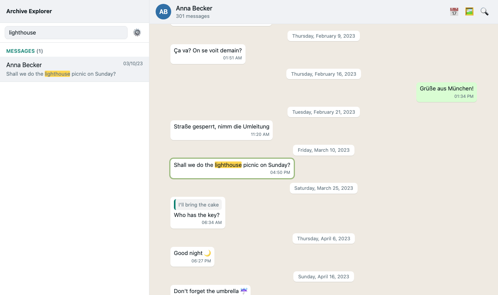
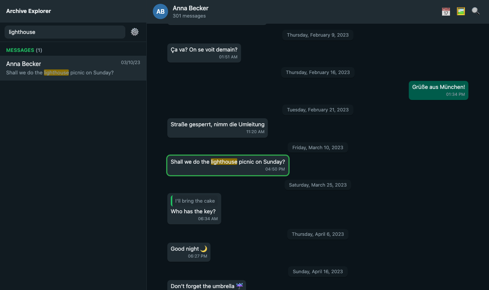
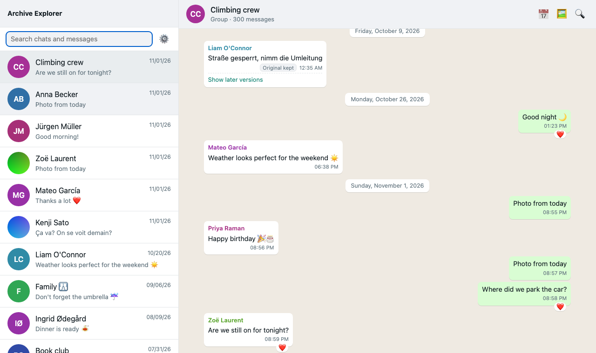

# whatsapp-archive-explorer

Browse and search your exported WhatsApp history like in WhatsApp itself — chat list, chats, media, and
full-text search across **every** chat — from **one self-contained executable** that runs entirely on your own
computer.

It reads the output of [WhatsApp-Chat-Exporter](https://github.com/KnugiHK/WhatsApp-Chat-Exporter) **read-only**.



> **Not affiliated with WhatsApp or Meta.** "WhatsApp" is a trademark of WhatsApp LLC. This project uses no
> WhatsApp logo, fonts or design assets. All screenshots show generated demo data.

## Features

- **Chat list** like WhatsApp — newest first, avatars or initials, last message, live filter (accents ignored:
  `muller` finds `Müller`).
- **Chats** — bubbles, group sender names, day dividers, replies (click to jump to the original), reactions,
  photos, videos, voice messages, documents, contact cards, calls, system messages.
- **Timeline** — above every chat, its whole life at a glance: one bar per month (per day for short chats),
  height = how much you wrote. Click or drag to travel years back in one move; search hits show as dots; arrow
  keys step to the previous/next month with messages.
- **Search on every level** — across all chats (grouped results with highlighted snippets, filters for sender,
  date range and media; click a hit to open the chat right there), inside a chat (next/previous), jump to a date.
  Words, numbers like `3.5`, email addresses and links are found; emoji are not searchable.
- **Media** — full-screen viewer and a per-chat gallery.
- **Archive-aware** — if your archive keeps edited or "deleted for everyone" messages (see
  [docs/format.md](docs/format.md)), the original is shown with a marker and later versions on demand.
- **Fast** — the first start builds a search index (one to three minutes for ~500,000 messages, depending on
  disk/network); later starts only check the files and re-read chats that changed, usually within seconds.
  Smooth with chats of 50,000+ messages.
- **Hidden chats** — WhatsApp keeps side entries it never lists (group members, channels, …). If the decrypted
  `msgstore.db` lies in the export folder, they are hidden like in WhatsApp; a filter switch shows them, and search
  still covers them.
- English and German, light and dark mode (follows your system).

 

## Privacy and security

- Accepts connections from this computer only (`127.0.0.1`), whatever configuration or environment variables say. Nothing is sent anywhere: no telemetry, no update checks, no
  fonts or scripts from the internet.
- **Never writes into your export folder.** The search index lives in your user cache folder
  (`~/Library/Caches/whatsapp-archive-explorer` on macOS, `~/.cache/…` on Linux, `%LOCALAPPDATA%\…` on Windows),
  readable only by you. `--no-cache` keeps it in memory instead.
- Other websites open in your browser cannot read your chats: the server answers only requests addressed to
  `localhost`/`127.0.0.1` from its own pages, and serves everything with a strict content security policy.
- Message content is sanitised before display; files from the archive that could run code (HTML, SVG, …) are
  only offered as downloads.
- The terminal shows counts and paths only — never chat names or message text.

## Getting started

1. **Export** your chats with WhatsApp-Chat-Exporter, as per-chat JSON plus the media folder, e.g.

   ```sh
   wtsexporter -a -k <key> -b msgstore.db.crypt15 -m WhatsApp -o export -j json --per-chat
   ```

   (Any layout with `json/*.json` or `result.json` next to the media folder works.)

2. **Download** the file for your system from the [releases](../../releases), unpack it, and run:

   ```sh
   ./whatsapp-archive-explorer path/to/export
   ```

   Your browser opens at `http://127.0.0.1:<port>/`. Press Ctrl+C in the terminal to stop.

   - **macOS:** the program is not notarised. Starting it from the terminal works; in Finder use right-click →
     *Open* the first time.
   - **Windows:** SmartScreen may show "Windows protected your PC" for a fresh download → *More info* →
     *Run anyway*.

### Names and profile pictures

WhatsApp backups contain neither contact names nor profile pictures (WhatsApp keeps them outside the backup).
Export your address book as a `.vcf` file — e.g. *Contacts app → Import/Export → Export to storage* on Android,
or [Google Contacts → Export → vCard](https://contacts.google.com) — and pass it along:

```sh
./whatsapp-archive-explorer path/to/export --contacts contacts.vcf --country-code 49
```

A `contacts.vcf` in the export folder is picked up automatically. Names and photos are matched by phone number and used for chats, group senders and reactions. `--country-code`
is needed for numbers saved without one (`0155…`). The file is only read; nothing is copied or stored.

Options: `--port <n>`, `--no-browser`, `--no-cache`, `--verbose`, `--listen <ip>` (exposes your chats to the
network — only on networks you trust), `--version`, `--help`.

Each release ships a `SHA256SUMS` file, signed keylessly with [Sigstore](https://www.sigstore.dev/), and build
provenance attestations.

## Building from source

Requirements: .NET 10 SDK, Node.js 22+.

```sh
dotnet run --project src/DemoArchive -- ./demo-archive        # synthetic export to play with
dotnet run --project src/Explorer -- ./demo-archive           # builds the UI and starts the explorer
dotnet publish src/Explorer -c Release -r osx-arm64 -o out    # single executable (osx-x64, linux-x64, win-x64, …)
```

Tests: `dotnet test` (backend), `npm test` / `npm run lint` in `src/web` (UI), `npm run e2e` in `src/web`
(end-to-end against a demo archive). See [CONTRIBUTING.md](CONTRIBUTING.md) and
[docs/architecture.md](docs/architecture.md).

## License

[MIT](LICENSE)
