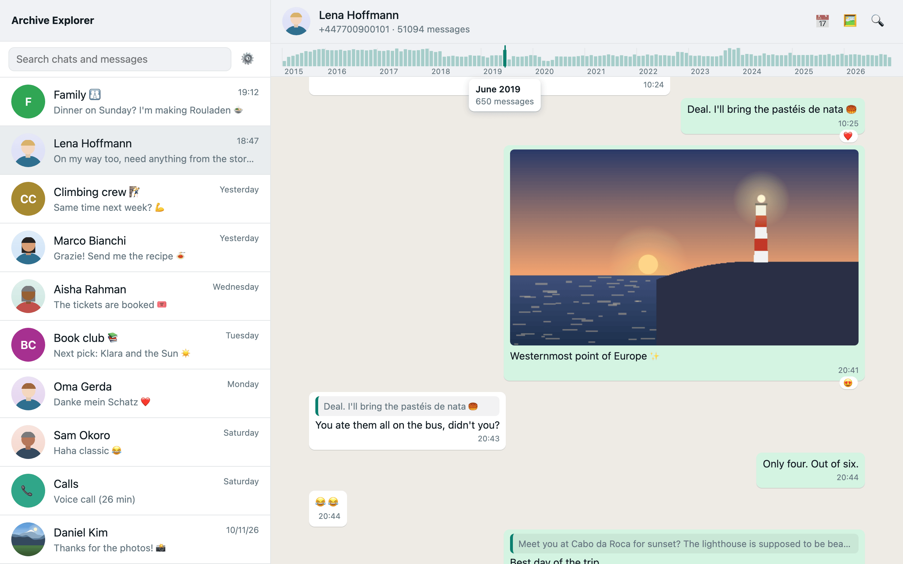
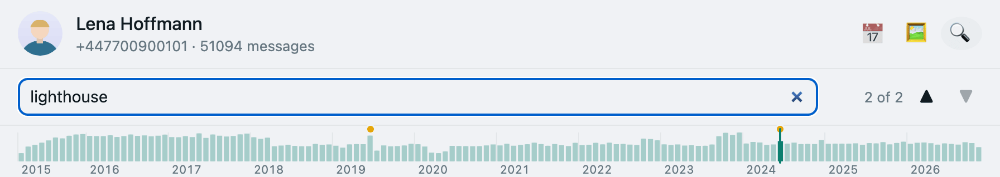
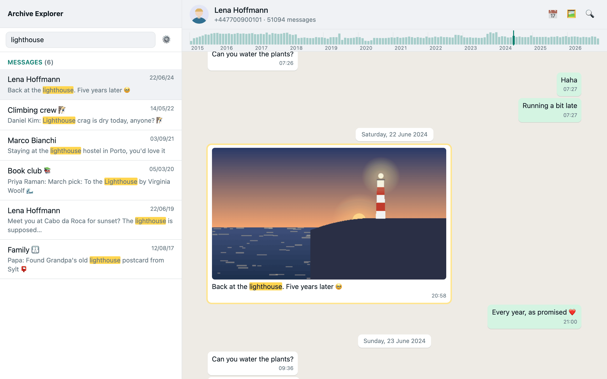
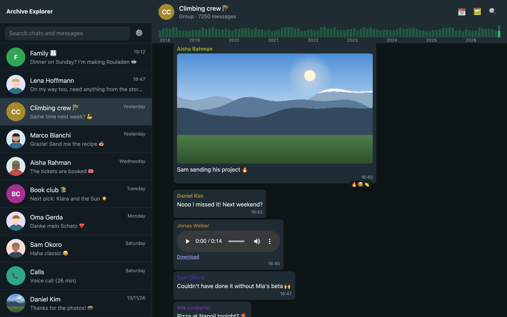
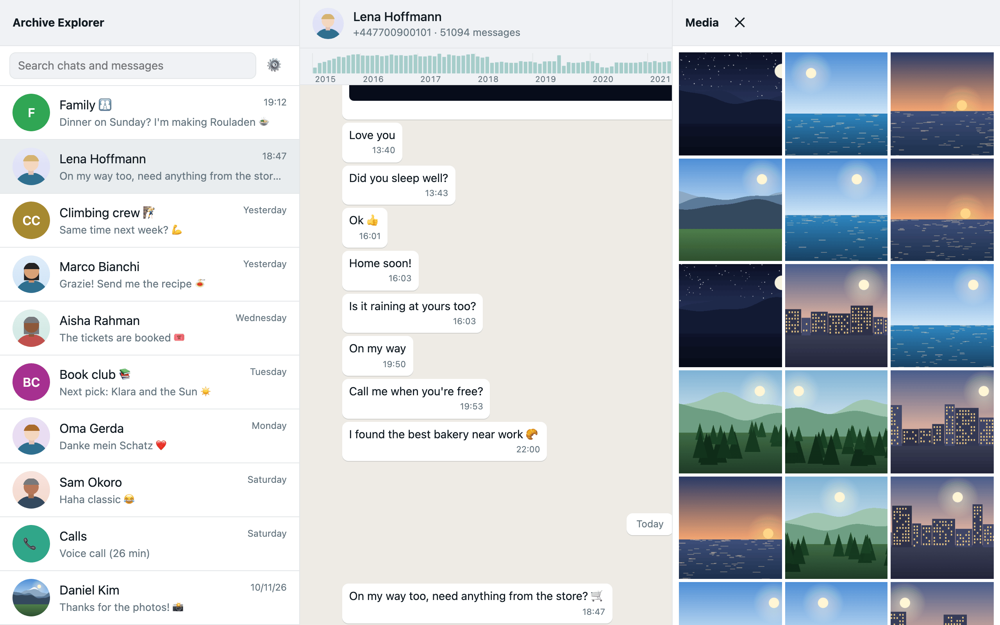
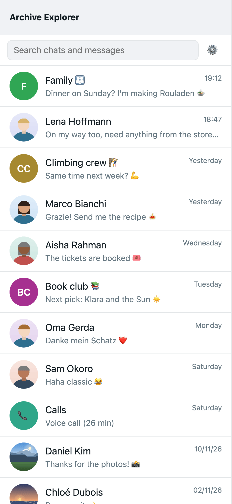
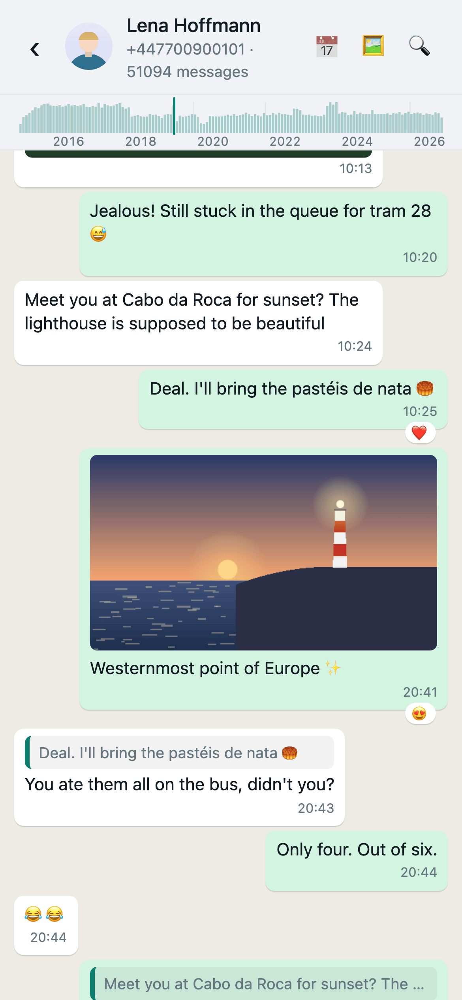

<p align="center">
  
</p>

<h1 align="center">Archive Explorer</h1>

<p align="center">
  <strong>Your whole WhatsApp history, searchable, on your own computer.</strong><br>
  Open years of exported chats in a familiar chat view, search every message at once, and jump to any month
  with one click. One file, no account, nothing leaves your machine.
</p>

<p align="center">
  <a href="https://github.com/nmehlei/whatsapp-archive-explorer/actions/workflows/ci.yml"></a>
  <a href="https://github.com/nmehlei/whatsapp-archive-explorer/releases/latest"></a>
  
  <a href="LICENSE"></a>
</p>



<sub>All screenshots show generated demo data: invented people, illustrated photos. Not affiliated with WhatsApp
or Meta; see the [note at the end](#trademarks).</sub>

## Why

WhatsApp is made for today's conversations. Reading something from five years ago means scrolling for minutes,
search works one chat at a time, and when you change phones you hope the backup comes along. Archive Explorer
turns an export of your chats into something you can actually browse:

- **Find anything.** One search across every chat and every year, with filters.
- **Travel in time.** A timeline above each chat shows its whole life; click 2017 and you're there.
- **Keep it.** Your archive is a folder on your computer, readable without the phone, without an account, and
  without an internet connection.

It reads the output of [WhatsApp-Chat-Exporter](https://github.com/KnugiHK/WhatsApp-Chat-Exporter), the
open-source tool that decrypts a WhatsApp backup. The [guide below](#guide-from-your-phone-to-your-archive)
walks you through the whole way, from the phone to the first search.

## Features

### A timeline for every chat



Above each chat sits its whole history at a glance: one bar per month (one per day for short chats), as high
as you wrote that month. Hover to see the month and its message count, click or drag to land there, use the
arrow keys to step from one busy month to the next. While you search inside a chat, its hits light up as amber
dots, so you see at once *when* you talked about something.

### Search on every level



- **Across all chats**: results grouped per chat with the matching words highlighted; filter by who sent it (you
  or others), date range or media. Click a hit and the chat opens right at that message.
- **Inside a chat**: next and previous through every hit.
- **By date**: jump to any day.

Accents don't matter (`muller` finds `Müller`), and numbers like `3.5`, email addresses and links are found too.
Emoji aren't searchable.

### Feels like the app you know

 

- Chat list sorted by latest message, with profile pictures or initials and a live filter.
- Message bubbles, group sender names, day dividers, replies (click to jump to the original), reactions.
- Photos, videos, voice messages, documents, contact cards and calls; a full-screen viewer and a per-chat
  media gallery.
- Light and dark mode (follows your system), English and German.

### Works on a phone-sized screen, too

<p>
  
  
</p>

### And under the hood

- **Fast with big archives.** The first start builds a search index: one to three minutes for about 500,000
  messages. Later starts only re-read chats that changed, usually within seconds. Chats with 50,000+ messages
  scroll smoothly.
- **Hidden chats stay hidden.** WhatsApp keeps side entries it never lists (former group members, channels, …).
  If the decrypted `msgstore.db` lies in the export folder, the explorer hides them too; a filter shows them and
  search still covers them.
- **Archive-aware.** Archives that keep edited or "deleted for everyone" messages show the original with a
  marker and the later versions on demand ([format details](docs/format.md)).

## Privacy and security

Your chats are some of the most private data you have. The explorer is built so they stay with you:

- **Nothing is sent anywhere.** No telemetry, no update checks, no fonts or scripts from the internet. It works
  with the network cable pulled.
- **Only this computer can connect.** The server listens on `127.0.0.1`, whatever configuration or
  environment variables say. Other websites open in your browser can't read your chats either: only requests to
  `localhost`/`127.0.0.1` from the explorer's own pages are answered, under a strict content security policy.
- **Your export is never changed.** The search index lives in your user cache folder
  (`~/Library/Caches/whatsapp-archive-explorer` on macOS, `~/.cache/…` on Linux, `%LOCALAPPDATA%\…` on
  Windows), readable only by you. `--no-cache` keeps it in memory instead.
- **Safe display.** Message text is sanitised; files from the archive that could run code (HTML, SVG, …) are
  only offered as downloads.
- **Quiet terminal.** It prints counts and paths, never chat names or message text.
- **Nothing to install on the phone.** The guide below uses WhatsApp's own backup; your chats on the phone are
  not touched.

## Guide: from your phone to your archive

You need an **Android phone**, a computer (macOS, Windows or Linux) and about half an hour the first time.
On an iPhone, see [iPhone](#iphone).

### 1. Make a backup with a 64-digit key

WhatsApp encrypts its backups. With a 64-digit key instead of a password you can decrypt them yourself:

1. In WhatsApp, open **Settings → Chats → Chat backup → End-to-end encrypted backup** and turn it on.
2. Choose **Use 64-digit encryption key instead**, and write the key down somewhere safe, e.g. in your password
   manager. Treat it like a password: whoever has the key and the backup can read your chats.
3. Back on the Chat backup screen, tap **Back up**.

This only changes how the backup is protected; your chats on the phone stay exactly as they are. If you lose the
key, that backup can't be restored, so keep it.

### 2. Copy the WhatsApp folder to your computer

Make a folder for your archive, e.g. `whatsapp-archive`. Connect the phone by USB, choose **File transfer** on
the phone, and copy this folder from the phone into it:

```
Internal storage/Android/media/com.whatsapp/WhatsApp
```

It holds `Databases/msgstore.db.crypt15` (your messages) and `Media/` (photos, videos, voice messages). On a Mac
you need a helper such as [OpenMTP](https://openmtp.ganeshrvel.com/) to see the phone's files; on Windows and
Linux the phone appears in the file manager. With Android's developer tools,
`adb pull /sdcard/Android/media/com.whatsapp/WhatsApp whatsapp-archive/` does the same.

### 3. Decrypt and export with WhatsApp-Chat-Exporter

Install [WhatsApp-Chat-Exporter](https://github.com/KnugiHK/WhatsApp-Chat-Exporter) (needs Python 3.10+):

```sh
python3 -m pip install "whatsapp-chat-exporter[android_backup,crypt15]"
```

Then run it **inside** your archive folder, so everything ends up side by side:

```sh
cd whatsapp-archive
wtsexporter -a -k -b WhatsApp/Databases/msgstore.db.crypt15 -m WhatsApp -o . -j json --per-chat --no-html
```

- `-k` without a value makes the exporter ask for the 64-digit key, so it doesn't end up in your shell history.
- `--no-html` skips the exporter's own HTML pages, which the explorer doesn't need.

Afterwards the folder holds `json/` (one file per chat), your `WhatsApp/` media folder as copied, and the
decrypted `msgstore.db`, which the explorer uses to hide chats WhatsApp hides. (Any folder with `json/*.json` or
a `result.json` next to the media folder works.)

> [!IMPORTANT]
> These files are an **unencrypted** copy of all your chats. Keep the folder on an encrypted disk (FileVault,
> BitLocker, LUKS) or an encrypted external drive, and don't put it in a shared or cloud-synced folder.

### 4. Open your archive

Download the file for your system from the [latest release](https://github.com/nmehlei/whatsapp-archive-explorer/releases/latest),
unpack it, and start it in a terminal with your archive folder:

```sh
./whatsapp-archive-explorer path/to/whatsapp-archive          # macOS, Linux
.\whatsapp-archive-explorer.exe path\to\whatsapp-archive      # Windows
```

Your browser opens at `http://127.0.0.1:<port>/`. The first start builds the search index (you'll see its
progress), after that you're in. Press Ctrl+C in the terminal to stop.

- **macOS:** the program is not notarised, so macOS blocks it the first time. Either allow it under
  *System Settings → Privacy & Security → Open Anyway*, or remove the download flag once:
  `xattr -d com.apple.quarantine whatsapp-archive-explorer`.
- **Windows:** SmartScreen may say "Windows protected your PC" for a fresh download → *More info* →
  *Run anyway*.

Each release ships a `SHA256SUMS` file, signed keylessly with [Sigstore](https://www.sigstore.dev/), plus build
provenance attestations, so you can check that the file is the one built here.

### 5. Optional: names and profile pictures

A WhatsApp backup contains neither your contacts' names nor their profile pictures, so chats show phone numbers
at first. Export your address book as a `.vcf` file (on Android: *Contacts → Import/Export → Export to
storage*; or [Google Contacts → Export → vCard](https://contacts.google.com)) and either put it into the archive
folder as `contacts.vcf` or pass it along:

```sh
./whatsapp-archive-explorer path/to/whatsapp-archive --contacts contacts.vcf --country-code 49
```

Names and photos are matched by phone number and used for chats, group senders and reactions. `--country-code`
is needed for numbers saved without one (`0155…`). The file is only read; nothing is copied or stored. The
profile pictures shown are the ones in your address book: WhatsApp keeps people's own WhatsApp pictures outside
the backup, where no tool can reach them without rooting the phone.

### Keeping your archive up to date

Whenever you like: make a fresh **Back up** in WhatsApp, copy the phone's `WhatsApp` folder into your archive
folder again (let it add the new files), and run the same `wtsexporter` command there. Start the explorer: it
notices which chats changed and only re-reads those.

A new export shows the phone as it is today, so messages you deleted in the meantime are gone from it. To keep
those too, keep a copy of the previous `json/` folder.

### iPhone

WhatsApp-Chat-Exporter can also read iPhone backups made with Finder or iTunes; see
[its documentation](https://github.com/KnugiHK/WhatsApp-Chat-Exporter). The explorer is
developed and tested with Android exports. If you try an iPhone export, an
[issue](https://github.com/nmehlei/whatsapp-archive-explorer/issues) telling how it went (without chat content!)
is very welcome.

## Questions and troubleshooting

<details>
<summary><strong>Does any of this change WhatsApp on my phone?</strong></summary>

No. You use WhatsApp's own backup screen and copy files off the phone; nothing is installed or written on it.
Turning on the end-to-end encrypted backup only changes how future backups are protected.
</details>

<details>
<summary><strong>The exporter says the key is wrong or can't decrypt.</strong></summary>

Check that you typed all 64 digits, and that the backup was made *after* you set this key: an older
`msgstore.db.crypt15` was encrypted differently. Make a fresh backup in WhatsApp and copy the folder again.
</details>

<details>
<summary><strong>My chats show phone numbers instead of names.</strong></summary>

That's expected: the backup has no names. Add your address book, see
[step 5](#5-optional-names-and-profile-pictures). For numbers saved without a country code, add
`--country-code`.
</details>

<details>
<summary><strong>Some photos or voice messages are missing.</strong></summary>

Media you deleted on the phone, or that WhatsApp's storage cleanup removed, isn't in the `WhatsApp` folder
anymore. The explorer shows a "missing" placeholder for files that aren't in the export.
</details>

<details>
<summary><strong>Can I open it on my phone or another computer?</strong></summary>

By default only the computer it runs on can connect, on purpose. `--listen 0.0.0.0` opens it to your network,
which means anyone on that network can read your chats. Only do this on a network you trust.
</details>

<details>
<summary><strong>Where is the search index, and how do I remove it?</strong></summary>

In your user cache folder (see [Privacy and security](#privacy-and-security)). Deleting that folder removes it;
the next start rebuilds it. Your export is never touched.
</details>

## Options

| Option | What it does |
| --- | --- |
| `--contacts <file.vcf>` | Names and profile pictures from your address book |
| `--country-code <n>` | Country code for numbers in the `.vcf` saved without one, e.g. `49` |
| `--port <n>` | Use this port instead of a free one |
| `--no-browser` | Don't open the browser |
| `--no-cache` | Keep the search index in memory only |
| `--listen <ip>` | Also accept connections on this address (exposes your chats to that network) |
| `--verbose` | More progress output (counts only) |
| `--version`, `--help` | Version and help |

## Building from source

Requirements: .NET 10 SDK, Node.js 22+.

```sh
dotnet run --project src/DemoArchive -- ./demo-archive        # a small synthetic export to play with
dotnet run --project src/Explorer -- ./demo-archive           # builds the UI and starts the explorer
dotnet publish src/Explorer -c Release -r osx-arm64 -o out    # single executable (osx-x64, linux-x64, win-x64, …)
```

Tests: `dotnet test` (backend), `npm test` and `npm run lint` in `src/web` (UI), `npm run e2e` in `src/web`
(end-to-end against a demo archive). `npm run screenshots` regenerates every picture in this README from the
scripted showcase archive (`dotnet run --project src/DemoArchive -- ./showcase --showcase`). See
[CONTRIBUTING.md](CONTRIBUTING.md) and [docs/architecture.md](docs/architecture.md).

## Trademarks

Archive Explorer is an independent open-source project, not affiliated with, endorsed or sponsored by WhatsApp
LLC or Meta Platforms, Inc. "WhatsApp" is a trademark of WhatsApp LLC, used here only to say which exports the
tool reads. The project uses no WhatsApp logos, fonts or design assets.

## License

[MIT](LICENSE)
