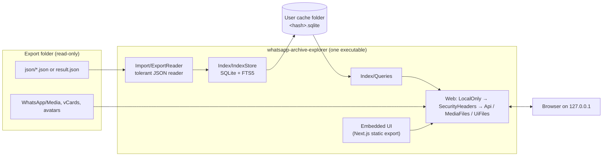

# Architecture

- **Import** (`src/Explorer/Import`) reads one export file at a time. Unknown fields are ignored; broken files
  and malformed messages are skipped and counted (counts only are logged).
- **Index** (`src/Explorer/Index`) keeps chats, messages and an FTS5 table (`unicode61 remove_diacritics 2`,
  prefix search) in an SQLite file in the user cache folder. Each export file has a fingerprint (size + mtime);
  a refresh re-reads only changed files and drops removed ones. A schema version change rebuilds the index.
- **Web** (`src/Explorer/Web`): `LocalOnly` rejects foreign `Host` headers (DNS rebinding) and cross-site API
  calls; `SecurityHeaders` sets a strict CSP that allows the UI's inline scripts by SHA-256 only; `MediaFiles`
  serves archive files after resolving every symlink and only shows passive media inline; `HtmlSafe` sanitises
  message HTML to a tiny allow-list.
- **UI** (`src/web`): Next.js App Router, static export, React with `react-virtuoso` for long lists. The build is
  embedded into the executable as resources (`ui/…`).
- **Demo data** (`src/DemoArchive`): a deterministic generator of exporter-shaped JSON and media with fictional
  people — used by tests, screenshots and anyone reproducing a bug.
